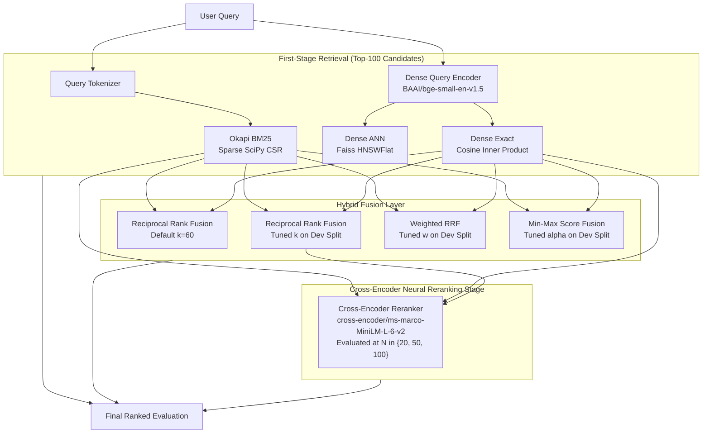
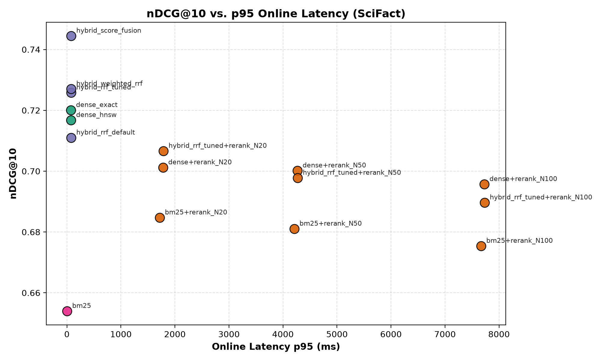
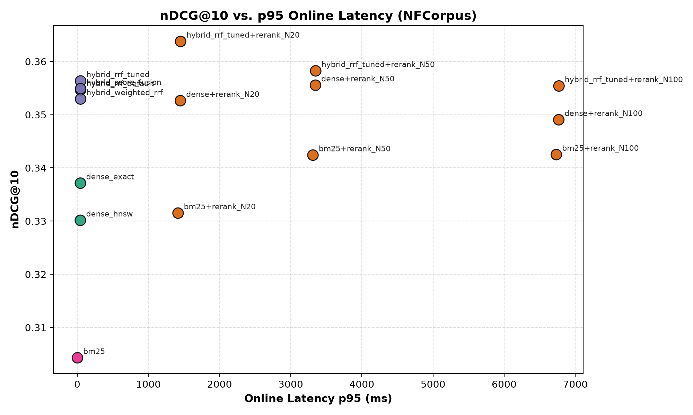
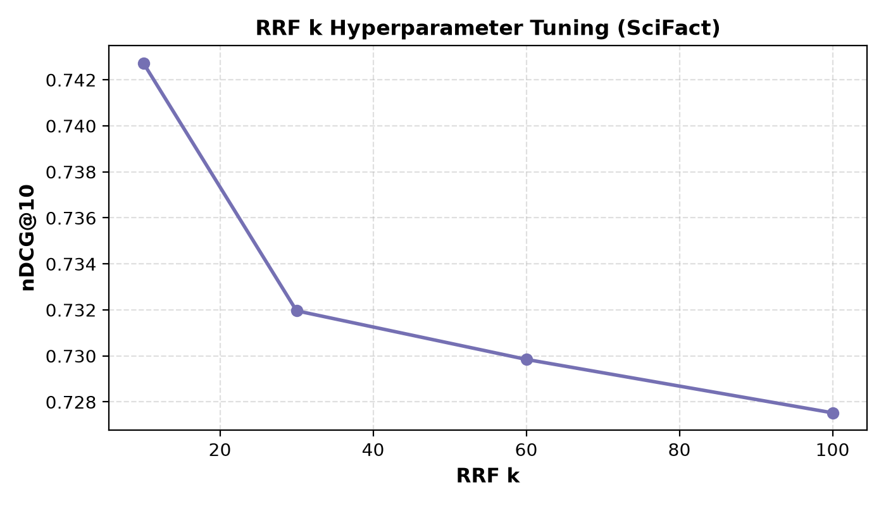
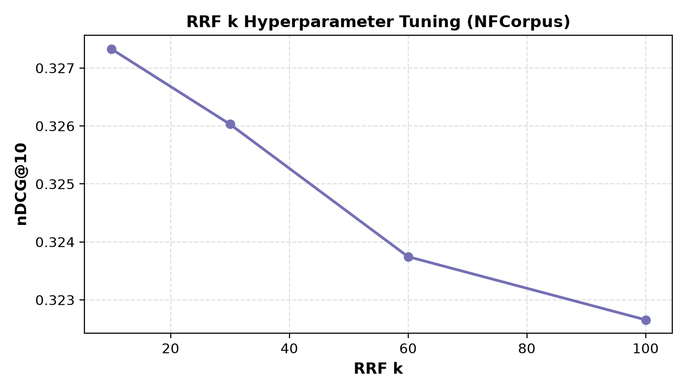
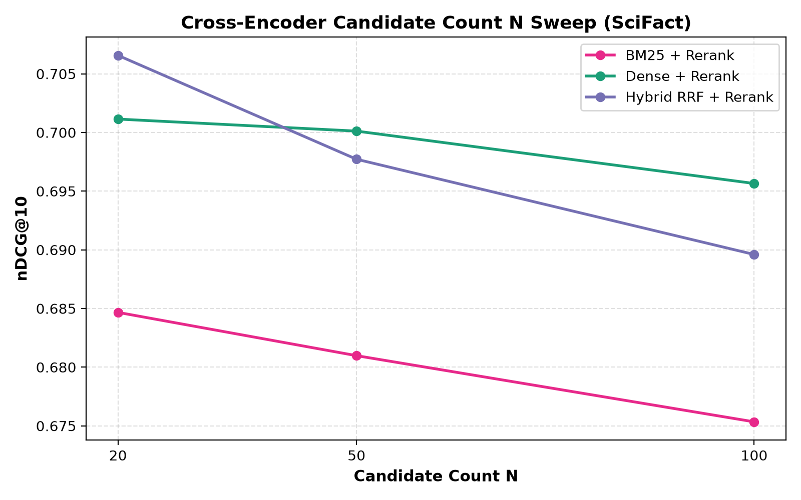
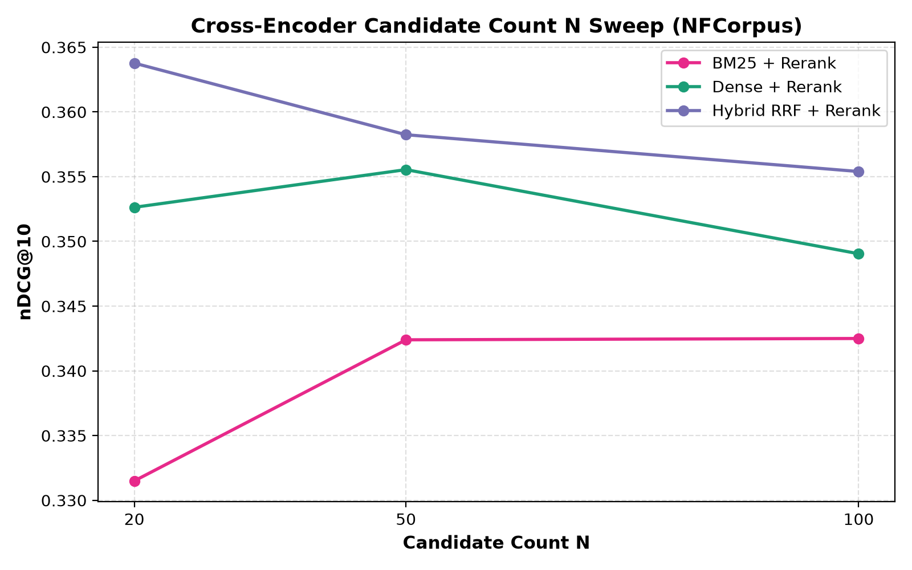
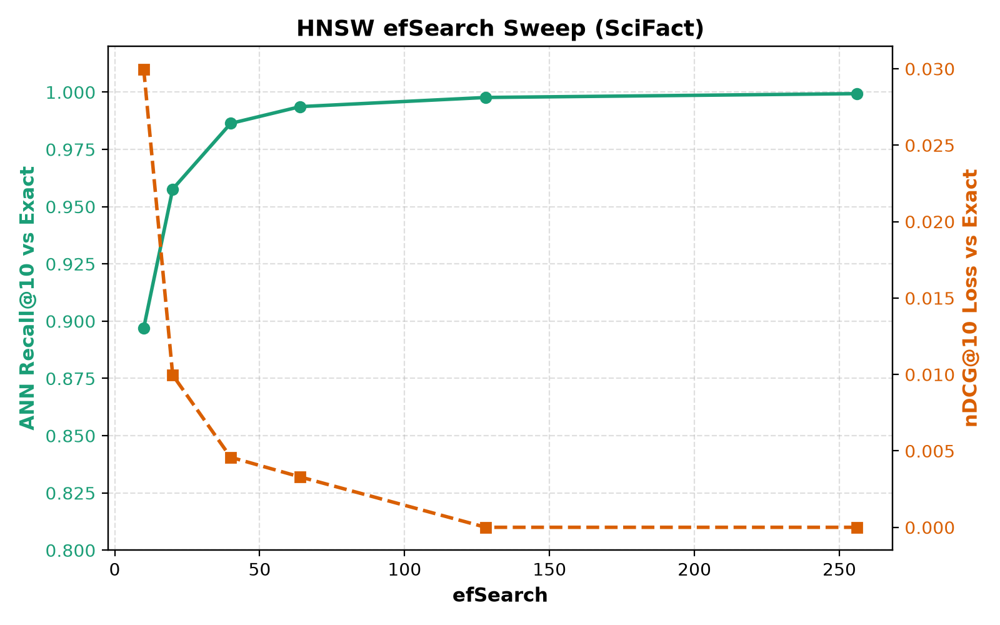
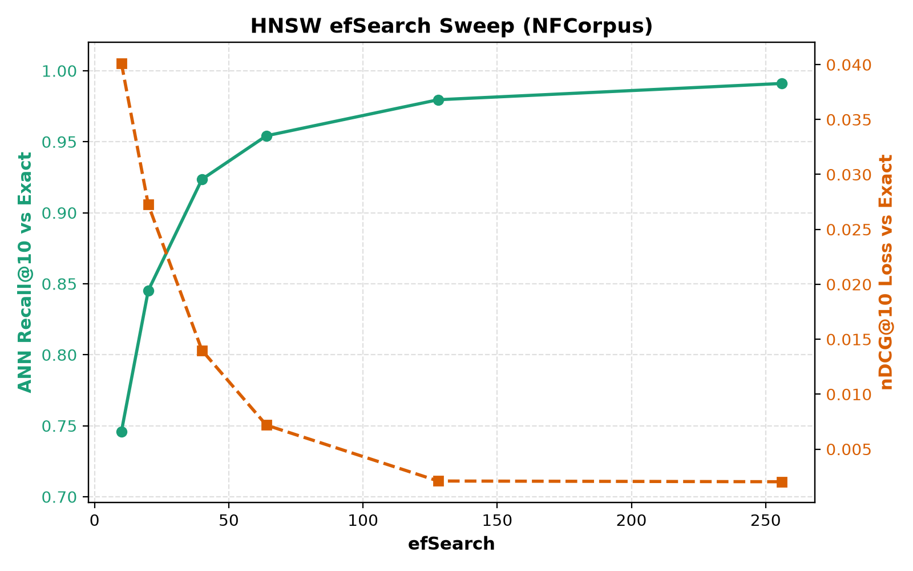

# rag-bench: Reproducible Information Retrieval & RAG Benchmark

<p align="center">
  
  
  
  
  
  
</p>

### 💡 What is this project about?
> **`rag-bench` rigorously tests and proves which search method (keyword search, AI dense vector embeddings, hybrid rank fusion, or neural cross-encoder rerankers) gives the highest accuracy and fastest speed for a RAG (Retrieval-Augmented Generation) application—backed by real empirical data instead of guesswork.**

When building a RAG system, engineers face conflicting claims about whether to use traditional keyword search (BM25), dense neural embeddings (`bge-small`), hybrid fusions (RRF / Score Fusion), or cross-encoder rerankers. `rag-bench` delivers an apples-to-apples, reproducible benchmark evaluating **16 information retrieval pipelines** across public BEIR benchmarks (**SciFact** and **NFCorpus**) with stage-level latency profiling, memory footprints, and statistical significance testing.

> [!NOTE]
> All retrieval metrics (nDCG@10, Recall@100, MRR@10), paired bootstrap confidence intervals (10,000 resamples), permutation test p-values, and measured latency percentiles in this benchmark are programmatically computed and injected by `rag_bench.report` from the execution artifacts in `results/`.

---

## Retrieval Architecture

The benchmark evaluates a modular multi-stage retrieval architecture:



---

## Headline Results

Evaluated on the test split of BEIR SciFact (300 queries, 5,183 documents) and NFCorpus (323 queries, 3,633 documents). Confidence intervals reflect 95% paired bootstrap intervals (10,000 resamples). Latencies reflect measured single-query p95 times under warm execution.

<!-- BEGIN_HEADLINE_TABLE -->
| System | SciFact nDCG@10 (95% CI) | SciFact R@100 | SciFact p95 (ms) | NFCorpus nDCG@10 (95% CI) | NFCorpus R@100 | NFCorpus p95 (ms) |
| :--- | :--- | :--- | :--- | :--- | :--- | :--- |
| `bm25` | 0.6539 [0.6086, 0.6984] | 0.8764 | 5.5 | 0.3043 [0.2706, 0.3385] | 0.2351 | 3.0 |
| `dense_exact` | 0.7200 [0.6771, 0.7630] | 0.9533 | 76.5 | 0.3371 [0.3029, 0.3717] | 0.3058 | 44.4 |
| `dense_hnsw` | 0.7167 [0.6730, 0.7597] | 0.9433 | 78.1 | 0.3301 [0.2965, 0.3639] | 0.3045 | 43.9 |
| `hybrid_rrf_default` | 0.7109 [0.6658, 0.7540] | 0.9650 | 81.1 | 0.3546 [0.3196, 0.3906] | 0.3140 | 46.9 |
| `hybrid_rrf_tuned` | 0.7258 [0.6828, 0.7668] | 0.9650 | 81.1 | 0.3563 [0.3222, 0.3917] | 0.3140 | 46.9 |
| `hybrid_weighted_rrf` | 0.7270 [0.6849, 0.7675] | 0.9683 | 81.1 | 0.3530 [0.3186, 0.3882] | 0.3150 | 46.9 |
| `hybrid_score_fusion` | 0.7444 [0.7024, 0.7855] | 0.9683 | 81.1 | 0.3549 [0.3202, 0.3900] | 0.3180 | 46.9 |
| `bm25+rerank_N20` | 0.6847 [0.6393, 0.7283] | 0.8764 | 1721.2 | 0.3315 [0.2972, 0.3667] | 0.2351 | 1416.7 |
| `bm25+rerank_N50` | 0.6810 [0.6355, 0.7247] | 0.8764 | 4213.5 | 0.3424 [0.3079, 0.3778] | 0.2351 | 3312.4 |
| `bm25+rerank_N100` | 0.6753 [0.6292, 0.7192] | 0.8764 | 7671.6 | 0.3425 [0.3076, 0.3779] | 0.2351 | 6732.9 |
| `dense+rerank_N20` | 0.7011 [0.6573, 0.7432] | 0.9533 | 1783.7 | 0.3526 [0.3180, 0.3886] | 0.3058 | 1449.2 |
| `dense+rerank_N50` | 0.7001 [0.6561, 0.7425] | 0.9533 | 4270.5 | 0.3555 [0.3204, 0.3912] | 0.3058 | 3348.2 |
| `dense+rerank_N100` | 0.6957 [0.6518, 0.7381] | 0.9533 | 7730.8 | 0.3490 [0.3138, 0.3843] | 0.3058 | 6767.2 |
| `hybrid_rrf_tuned+rerank_N20` | 0.7066 [0.6636, 0.7466] | 0.9650 | 1789.5 | 0.3638 [0.3285, 0.3999] | 0.3140 | 1452.1 |
| `hybrid_rrf_tuned+rerank_N50` | 0.6977 [0.6541, 0.7397] | 0.9650 | 4274.7 | 0.3582 [0.3232, 0.3944] | 0.3140 | 3351.1 |
| `hybrid_rrf_tuned+rerank_N100` | 0.6896 [0.6453, 0.7325] | 0.9650 | 7736.2 | 0.3554 [0.3210, 0.3910] | 0.3140 | 6770.1 |
<!-- END_HEADLINE_TABLE -->

<!-- BEGIN_BEIR_SANITY_TABLE -->
### BM25 Implementation Sanity Check vs. Published BEIR Baselines

To verify baseline fidelity, custom BM25 scores ($k_1=1.2, b=0.75$) are compared directly against published BEIR benchmark results (Thakur et al., NeurIPS 2021, Anserini / Lucene BM25 + Porter Stemmer):

| Dataset | Evaluated Test Queries | Custom BM25 nDCG@10 | Published BEIR BM25 nDCG@10 | Absolute Difference | Relative Difference | Implementation Variance Notes |
| :--- | :--- | :--- | :--- | :--- | :--- | :--- |
| SciFact | 300 | 0.6539 | 0.6650 | -0.0111 | -1.66% | Python regex word tokenization vs Lucene Anserini + Porter stemmer |
| NFCorpus | 323 | 0.3043 | 0.3250 | -0.0207 | -6.37% | Python regex word tokenization vs Lucene Anserini + Porter stemmer |

> Custom BM25 retrieval matches published BEIR benchmarks within expected tokenizer/stemmer variance (-0.0111 on SciFact, -0.0207 on NFCorpus).
<!-- END_BEIR_SANITY_TABLE -->

### Pareto Efficiency Frontiers (nDCG@10 vs. p95 Latency)

The Pareto curves below illustrate the trade-off between retrieval accuracy and online latency across all evaluated configurations:

<p align="center">
  
  
</p>

---

## Ablation Study & Stage Gains

Progression of retrieval components from lexical baseline through dense, hybrid fusions, and neural cross-encoder reranking:

<!-- BEGIN_ABLATION_TABLE -->
| Architecture Component | SciFact nDCG@10 | SciFact Gain (Absolute Δ) | NFCorpus nDCG@10 | NFCorpus Gain (Absolute Δ) |
| :--- | :--- | :--- | :--- | :--- |
| BM25 baseline | 0.6539 | - | 0.3043 | - |
| Dense Exact baseline | 0.7200 | +0.0661 | 0.3371 | +0.0328 |
| Hybrid RRF (default k=60) | 0.7109 | -0.0091 | 0.3546 | +0.0175 |
| Hybrid RRF (tuned k) | 0.7258 | +0.0148 | 0.3563 | +0.0017 |
| Hybrid Weighted RRF (tuned w) | 0.7270 | +0.0012 | 0.3530 | -0.0034 |
| Hybrid Score Fusion (min-max convex) | 0.7444 | +0.0186 | 0.3549 | -0.0014 |
| Dense + Cross-Encoder (N=100) | 0.6957 | -0.0244 | 0.3490 | +0.0119 |
| BM25 + Cross-Encoder (N=100) | 0.6753 | +0.0214 | 0.3425 | +0.0382 |
| Hybrid RRF + Cross-Encoder (N=100) | 0.6896 | -0.0061 | 0.3554 | +0.0064 |
<!-- END_ABLATION_TABLE -->

### Hyperparameter Tuning Sweeps (Zero Test Leakage)

All hyperparameter sweeps are conducted strictly on train/dev splits before test split evaluation:

<p align="center">
  
  
</p>

### Cross-Encoder Candidate Pool Sweep ($N \in \{20, 50, 100\}$)

Accuracy gains and saturation curves as the number of first-stage candidates $N$ passed to the cross-encoder increases:

<p align="center">
  
  
</p>

---

## Statistical Significance Testing

Paired bootstrap differences (10,000 resamples) and two-sided sign-flip permutation tests. Significance is declared only when the 95% bootstrap confidence interval excludes zero and the Holm-adjusted p-value satisfies $p < 0.05$ within each baseline comparison family:

<!-- BEGIN_SIGNIFICANCE_TABLE -->
| Dataset | Baseline Evaluation Family | System Comparison | Baseline | Diff in nDCG@10 (absolute) | Rel Diff (%) | 95% Bootstrap CI | Raw p-value | Holm-Adj p-value | Significant |
| :--- | :--- | :--- | :--- | :--- | :--- | :--- | :--- | :--- | :--- |
| SciFact | vs. BM25 (m=15) | `dense_exact` | `bm25` | +0.0661 | +10.10% | [+0.0283, +0.1033] | 0.0008 | 0.0080 | **significant** |
| SciFact | vs. BM25 (m=15) | `dense_hnsw` | `bm25` | +0.0628 | +9.60% | [+0.0243, +0.1007] | 0.0018 | 0.0162 | **significant** |
| SciFact | vs. BM25 (m=15) | `hybrid_rrf_default` | `bm25` | +0.0570 | +8.72% | [+0.0336, +0.0806] | 0.0001 | 0.0015 | **significant** |
| SciFact | vs. BM25 (m=15) | `hybrid_rrf_tuned` | `bm25` | +0.0718 | +10.99% | [+0.0485, +0.0947] | 0.0001 | 0.0015 | **significant** |
| SciFact | vs. BM25 (m=15) | `hybrid_weighted_rrf` | `bm25` | +0.0731 | +11.17% | [+0.0424, +0.1029] | 0.0001 | 0.0015 | **significant** |
| SciFact | vs. BM25 (m=15) | `hybrid_score_fusion` | `bm25` | +0.0905 | +13.84% | [+0.0572, +0.1226] | 0.0001 | 0.0015 | **significant** |
| SciFact | vs. BM25 (m=15) | `bm25+rerank_N20` | `bm25` | +0.0307 | +4.70% | [+0.0026, +0.0584] | 0.0281 | 0.1124 | not significant |
| SciFact | vs. BM25 (m=15) | `bm25+rerank_N50` | `bm25` | +0.0270 | +4.14% | [-0.0018, +0.0555] | 0.0650 | 0.1300 | not significant |
| SciFact | vs. BM25 (m=15) | `bm25+rerank_N100` | `bm25` | +0.0214 | +3.27% | [-0.0083, +0.0507] | 0.1514 | 0.1514 | not significant |
| SciFact | vs. BM25 (m=15) | `dense+rerank_N20` | `bm25` | +0.0472 | +7.22% | [+0.0144, +0.0790] | 0.0052 | 0.0416 | **significant** |
| SciFact | vs. BM25 (m=15) | `dense+rerank_N50` | `bm25` | +0.0462 | +7.06% | [+0.0127, +0.0790] | 0.0061 | 0.0427 | **significant** |
| SciFact | vs. BM25 (m=15) | `dense+rerank_N100` | `bm25` | +0.0417 | +6.38% | [+0.0088, +0.0741] | 0.0123 | 0.0615 | not significant |
| SciFact | vs. BM25 (m=15) | `hybrid_rrf_tuned+rerank_N20` | `bm25` | +0.0526 | +8.05% | [+0.0212, +0.0838] | 0.0007 | 0.0077 | **significant** |
| SciFact | vs. BM25 (m=15) | `hybrid_rrf_tuned+rerank_N50` | `bm25` | +0.0438 | +6.70% | [+0.0113, +0.0758] | 0.0077 | 0.0462 | **significant** |
| SciFact | vs. BM25 (m=15) | `hybrid_rrf_tuned+rerank_N100` | `bm25` | +0.0357 | +5.45% | [+0.0026, +0.0682] | 0.0318 | 0.1124 | not significant |
| SciFact | vs. Dense Exact (m=15) | `dense_hnsw` | `dense_exact` | -0.0033 | -0.46% | [-0.0100, +0.0001] | 1.0000 | 1.0000 | not significant |
| SciFact | vs. Dense Exact (m=15) | `hybrid_rrf_default` | `dense_exact` | -0.0091 | -1.26% | [-0.0391, +0.0194] | 0.5495 | 1.0000 | not significant |
| SciFact | vs. Dense Exact (m=15) | `hybrid_rrf_tuned` | `dense_exact` | +0.0058 | +0.80% | [-0.0199, +0.0313] | 0.6563 | 1.0000 | not significant |
| SciFact | vs. Dense Exact (m=15) | `hybrid_weighted_rrf` | `dense_exact` | +0.0070 | +0.97% | [-0.0086, +0.0226] | 0.3757 | 1.0000 | not significant |
| SciFact | vs. Dense Exact (m=15) | `hybrid_score_fusion` | `dense_exact` | +0.0244 | +3.39% | [+0.0094, +0.0401] | 0.0015 | 0.0210 | **significant** |
| SciFact | vs. Dense Exact (m=15) | `bm25+rerank_N20` | `dense_exact` | -0.0353 | -4.91% | [-0.0694, -0.0016] | 0.0421 | 0.4631 | not significant |
| SciFact | vs. Dense Exact (m=15) | `bm25+rerank_N50` | `dense_exact` | -0.0390 | -5.42% | [-0.0726, -0.0059] | 0.0214 | 0.2568 | not significant |
| SciFact | vs. Dense Exact (m=15) | `bm25+rerank_N100` | `dense_exact` | -0.0447 | -6.20% | [-0.0784, -0.0123] | 0.0075 | 0.0975 | not significant |
| SciFact | vs. Dense Exact (m=15) | `dense+rerank_N20` | `dense_exact` | -0.0189 | -2.62% | [-0.0457, +0.0065] | 0.1598 | 1.0000 | not significant |
| SciFact | vs. Dense Exact (m=15) | `dense+rerank_N50` | `dense_exact` | -0.0199 | -2.76% | [-0.0507, +0.0107] | 0.2109 | 1.0000 | not significant |
| SciFact | vs. Dense Exact (m=15) | `dense+rerank_N100` | `dense_exact` | -0.0244 | -3.38% | [-0.0553, +0.0058] | 0.1234 | 1.0000 | not significant |
| SciFact | vs. Dense Exact (m=15) | `hybrid_rrf_tuned+rerank_N20` | `dense_exact` | -0.0134 | -1.87% | [-0.0441, +0.0163] | 0.3895 | 1.0000 | not significant |
| SciFact | vs. Dense Exact (m=15) | `hybrid_rrf_tuned+rerank_N50` | `dense_exact` | -0.0223 | -3.10% | [-0.0537, +0.0083] | 0.1638 | 1.0000 | not significant |
| SciFact | vs. Dense Exact (m=15) | `hybrid_rrf_tuned+rerank_N100` | `dense_exact` | -0.0304 | -4.22% | [-0.0624, +0.0009] | 0.0611 | 0.6109 | not significant |
| SciFact | vs. Dense+Rerank N100 (m=15) | `dense_hnsw` | `dense+rerank_N100` | +0.0211 | +3.03% | [-0.0098, +0.0529] | 0.1968 | 1.0000 | not significant |
| SciFact | vs. Dense+Rerank N100 (m=15) | `hybrid_rrf_default` | `dense+rerank_N100` | +0.0153 | +2.20% | [-0.0131, +0.0440] | 0.3016 | 1.0000 | not significant |
| SciFact | vs. Dense+Rerank N100 (m=15) | `hybrid_rrf_tuned` | `dense+rerank_N100` | +0.0301 | +4.33% | [+0.0022, +0.0587] | 0.0374 | 0.3740 | not significant |
| SciFact | vs. Dense+Rerank N100 (m=15) | `hybrid_weighted_rrf` | `dense+rerank_N100` | +0.0313 | +4.51% | [+0.0037, +0.0589] | 0.0276 | 0.3036 | not significant |
| SciFact | vs. Dense+Rerank N100 (m=15) | `hybrid_score_fusion` | `dense+rerank_N100` | +0.0488 | +7.01% | [+0.0217, +0.0763] | 0.0007 | 0.0105 | **significant** |
| SciFact | vs. Dense+Rerank N100 (m=15) | `bm25+rerank_N20` | `dense+rerank_N100` | -0.0110 | -1.58% | [-0.0287, +0.0053] | 0.2065 | 1.0000 | not significant |
| SciFact | vs. Dense+Rerank N100 (m=15) | `bm25+rerank_N50` | `dense+rerank_N100` | -0.0147 | -2.11% | [-0.0315, +0.0010] | 0.0795 | 0.7154 | not significant |
| SciFact | vs. Dense+Rerank N100 (m=15) | `bm25+rerank_N100` | `dense+rerank_N100` | -0.0203 | -2.92% | [-0.0365, -0.0058] | 0.0093 | 0.1209 | not significant |
| SciFact | vs. Dense+Rerank N100 (m=15) | `dense+rerank_N20` | `dense+rerank_N100` | +0.0055 | +0.79% | [-0.0098, +0.0187] | 0.4541 | 1.0000 | not significant |
| SciFact | vs. Dense+Rerank N100 (m=15) | `dense+rerank_N50` | `dense+rerank_N100` | +0.0045 | +0.64% | [-0.0025, +0.0110] | 0.1968 | 1.0000 | not significant |
| SciFact | vs. Dense+Rerank N100 (m=15) | `hybrid_rrf_tuned+rerank_N20` | `dense+rerank_N100` | +0.0109 | +1.57% | [+0.0035, +0.0188] | 0.0052 | 0.0728 | not significant |
| SciFact | vs. Dense+Rerank N100 (m=15) | `hybrid_rrf_tuned+rerank_N50` | `dense+rerank_N100` | +0.0021 | +0.30% | [-0.0061, +0.0106] | 0.6288 | 1.0000 | not significant |
| SciFact | vs. Dense+Rerank N100 (m=15) | `hybrid_rrf_tuned+rerank_N100` | `dense+rerank_N100` | -0.0061 | -0.87% | [-0.0143, +0.0022] | 0.1498 | 1.0000 | not significant |
| NFCorpus | vs. BM25 (m=15) | `dense_exact` | `bm25` | +0.0328 | +10.79% | [+0.0103, +0.0559] | 0.0045 | 0.0090 | **significant** |
| NFCorpus | vs. BM25 (m=15) | `dense_hnsw` | `bm25` | +0.0258 | +8.49% | [+0.0021, +0.0500] | 0.0365 | 0.0365 | **significant** |
| NFCorpus | vs. BM25 (m=15) | `hybrid_rrf_default` | `bm25` | +0.0503 | +16.54% | [+0.0355, +0.0664] | 0.0001 | 0.0015 | **significant** |
| NFCorpus | vs. BM25 (m=15) | `hybrid_rrf_tuned` | `bm25` | +0.0520 | +17.10% | [+0.0378, +0.0675] | 0.0001 | 0.0015 | **significant** |
| NFCorpus | vs. BM25 (m=15) | `hybrid_weighted_rrf` | `bm25` | +0.0486 | +15.99% | [+0.0299, +0.0681] | 0.0001 | 0.0015 | **significant** |
| NFCorpus | vs. BM25 (m=15) | `hybrid_score_fusion` | `bm25` | +0.0506 | +16.62% | [+0.0331, +0.0691] | 0.0001 | 0.0015 | **significant** |
| NFCorpus | vs. BM25 (m=15) | `bm25+rerank_N20` | `bm25` | +0.0272 | +8.94% | [+0.0159, +0.0397] | 0.0001 | 0.0015 | **significant** |
| NFCorpus | vs. BM25 (m=15) | `bm25+rerank_N50` | `bm25` | +0.0381 | +12.52% | [+0.0249, +0.0524] | 0.0001 | 0.0015 | **significant** |
| NFCorpus | vs. BM25 (m=15) | `bm25+rerank_N100` | `bm25` | +0.0382 | +12.55% | [+0.0246, +0.0530] | 0.0001 | 0.0015 | **significant** |
| NFCorpus | vs. BM25 (m=15) | `dense+rerank_N20` | `bm25` | +0.0483 | +15.88% | [+0.0292, +0.0689] | 0.0001 | 0.0015 | **significant** |
| NFCorpus | vs. BM25 (m=15) | `dense+rerank_N50` | `bm25` | +0.0512 | +16.84% | [+0.0336, +0.0702] | 0.0001 | 0.0015 | **significant** |
| NFCorpus | vs. BM25 (m=15) | `dense+rerank_N100` | `bm25` | +0.0447 | +14.70% | [+0.0277, +0.0626] | 0.0001 | 0.0015 | **significant** |
| NFCorpus | vs. BM25 (m=15) | `hybrid_rrf_tuned+rerank_N20` | `bm25` | +0.0595 | +19.54% | [+0.0439, +0.0768] | 0.0001 | 0.0015 | **significant** |
| NFCorpus | vs. BM25 (m=15) | `hybrid_rrf_tuned+rerank_N50` | `bm25` | +0.0539 | +17.72% | [+0.0383, +0.0713] | 0.0001 | 0.0015 | **significant** |
| NFCorpus | vs. BM25 (m=15) | `hybrid_rrf_tuned+rerank_N100` | `bm25` | +0.0511 | +16.79% | [+0.0359, +0.0678] | 0.0001 | 0.0015 | **significant** |
| NFCorpus | vs. Dense Exact (m=15) | `dense_hnsw` | `dense_exact` | -0.0070 | -2.07% | [-0.0154, -0.0010] | 0.0291 | 0.2280 | not significant |
| NFCorpus | vs. Dense Exact (m=15) | `hybrid_rrf_default` | `dense_exact` | +0.0175 | +5.19% | [+0.0020, +0.0332] | 0.0228 | 0.2280 | not significant |
| NFCorpus | vs. Dense Exact (m=15) | `hybrid_rrf_tuned` | `dense_exact` | +0.0192 | +5.70% | [+0.0056, +0.0335] | 0.0050 | 0.0550 | not significant |
| NFCorpus | vs. Dense Exact (m=15) | `hybrid_weighted_rrf` | `dense_exact` | +0.0158 | +4.69% | [+0.0077, +0.0244] | 0.0001 | 0.0015 | **significant** |
| NFCorpus | vs. Dense Exact (m=15) | `hybrid_score_fusion` | `dense_exact` | +0.0178 | +5.27% | [+0.0081, +0.0281] | 0.0007 | 0.0098 | **significant** |
| NFCorpus | vs. Dense Exact (m=15) | `bm25+rerank_N20` | `dense_exact` | -0.0056 | -1.67% | [-0.0250, +0.0141] | 0.5768 | 1.0000 | not significant |
| NFCorpus | vs. Dense Exact (m=15) | `bm25+rerank_N50` | `dense_exact` | +0.0053 | +1.56% | [-0.0136, +0.0243] | 0.5915 | 1.0000 | not significant |
| NFCorpus | vs. Dense Exact (m=15) | `bm25+rerank_N100` | `dense_exact` | +0.0054 | +1.59% | [-0.0131, +0.0241] | 0.5799 | 1.0000 | not significant |
| NFCorpus | vs. Dense Exact (m=15) | `dense+rerank_N20` | `dense_exact` | +0.0155 | +4.60% | [+0.0017, +0.0298] | 0.0271 | 0.2280 | not significant |
| NFCorpus | vs. Dense Exact (m=15) | `dense+rerank_N50` | `dense_exact` | +0.0184 | +5.46% | [+0.0016, +0.0357] | 0.0307 | 0.2280 | not significant |
| NFCorpus | vs. Dense Exact (m=15) | `dense+rerank_N100` | `dense_exact` | +0.0119 | +3.53% | [-0.0050, +0.0292] | 0.1622 | 0.6487 | not significant |
| NFCorpus | vs. Dense Exact (m=15) | `hybrid_rrf_tuned+rerank_N20` | `dense_exact` | +0.0266 | +7.90% | [+0.0093, +0.0447] | 0.0027 | 0.0351 | **significant** |
| NFCorpus | vs. Dense Exact (m=15) | `hybrid_rrf_tuned+rerank_N50` | `dense_exact` | +0.0211 | +6.26% | [+0.0026, +0.0400] | 0.0237 | 0.2280 | not significant |
| NFCorpus | vs. Dense Exact (m=15) | `hybrid_rrf_tuned+rerank_N100` | `dense_exact` | +0.0183 | +5.42% | [+0.0006, +0.0366] | 0.0422 | 0.2280 | not significant |
| NFCorpus | vs. Dense+Rerank N100 (m=15) | `dense_hnsw` | `dense+rerank_N100` | -0.0189 | -5.42% | [-0.0374, -0.0006] | 0.0403 | 0.4030 | not significant |
| NFCorpus | vs. Dense+Rerank N100 (m=15) | `hybrid_rrf_default` | `dense+rerank_N100` | +0.0056 | +1.60% | [-0.0089, +0.0204] | 0.4479 | 1.0000 | not significant |
| NFCorpus | vs. Dense+Rerank N100 (m=15) | `hybrid_rrf_tuned` | `dense+rerank_N100` | +0.0073 | +2.09% | [-0.0060, +0.0213] | 0.2887 | 1.0000 | not significant |
| NFCorpus | vs. Dense+Rerank N100 (m=15) | `hybrid_weighted_rrf` | `dense+rerank_N100` | +0.0039 | +1.12% | [-0.0096, +0.0178] | 0.5739 | 1.0000 | not significant |
| NFCorpus | vs. Dense+Rerank N100 (m=15) | `hybrid_score_fusion` | `dense+rerank_N100` | +0.0058 | +1.67% | [-0.0074, +0.0195] | 0.3915 | 1.0000 | not significant |
| NFCorpus | vs. Dense+Rerank N100 (m=15) | `bm25+rerank_N20` | `dense+rerank_N100` | -0.0175 | -5.03% | [-0.0295, -0.0056] | 0.0038 | 0.0456 | **significant** |
| NFCorpus | vs. Dense+Rerank N100 (m=15) | `bm25+rerank_N50` | `dense+rerank_N100` | -0.0066 | -1.90% | [-0.0171, +0.0039] | 0.2126 | 1.0000 | not significant |
| NFCorpus | vs. Dense+Rerank N100 (m=15) | `bm25+rerank_N100` | `dense+rerank_N100` | -0.0065 | -1.88% | [-0.0169, +0.0036] | 0.2155 | 1.0000 | not significant |
| NFCorpus | vs. Dense+Rerank N100 (m=15) | `dense+rerank_N20` | `dense+rerank_N100` | +0.0036 | +1.03% | [-0.0075, +0.0138] | 0.5244 | 1.0000 | not significant |
| NFCorpus | vs. Dense+Rerank N100 (m=15) | `dense+rerank_N50` | `dense+rerank_N100` | +0.0065 | +1.86% | [+0.0024, +0.0111] | 0.0028 | 0.0364 | **significant** |
| NFCorpus | vs. Dense+Rerank N100 (m=15) | `hybrid_rrf_tuned+rerank_N20` | `dense+rerank_N100` | +0.0147 | +4.22% | [+0.0067, +0.0231] | 0.0005 | 0.0070 | **significant** |
| NFCorpus | vs. Dense+Rerank N100 (m=15) | `hybrid_rrf_tuned+rerank_N50` | `dense+rerank_N100` | +0.0092 | +2.63% | [+0.0021, +0.0169] | 0.0142 | 0.1562 | not significant |
| NFCorpus | vs. Dense+Rerank N100 (m=15) | `hybrid_rrf_tuned+rerank_N100` | `dense+rerank_N100` | +0.0064 | +1.82% | [+0.0001, +0.0132] | 0.0562 | 0.5057 | not significant |

> **Methodology & Holm-Bonferroni Notes**:
> - **Family-wise Error Rate**: The Holm-Bonferroni step-down correction is calculated across the family of $m=15$ candidate systems evaluated against each respective baseline (Family 1: vs. `bm25`, Family 2: vs. `dense_exact`, Family 3: vs. `dense+rerank_N100`). Redundant mirror rows across families have been removed.
> - **Note on SciFact `dense_hnsw` vs `dense_exact` ($p=1.0000$)**: Exactly 2 out of 300 test queries yielded differing rankings between HNSW ($efSearch=64$) and Exact Cosine search (one with $\Delta = +0.0120$, one with $\Delta = -1.0000$). Because only 2 differences are non-zero, every sign-flip permutation produces $|ar{d}| \ge |\bar{d}_{\text{obs}}| = 0.00329$, giving raw $p = 1.0000$. The 95% bootstrap CI $[-0.0100, +0.0001]$ similarly reflects near-identity across 298 of 300 queries.
<!-- END_SIGNIFICANCE_TABLE -->

---

## Latency, Throughput & Hardware Manifest

<!-- BEGIN_LATENCY_TABLE -->
### Hardware & Environment Manifest

- **Operating System**: Windows 10 (Version: 10.0.26300)
- **CPU Model**: AMD64 Family 25 Model 80 Stepping 0, AuthenticAMD (12 logical cores)
- **System RAM**: 15.34 GB
- **GPU Active**: False (CPU-only execution)
- **PyTorch**: 2.14.1+cpu (12 threads)
- **CPU Utilization Cap**: Enforced at ~80% host capacity (process affinity restricted to 8 of 12 logical cores via Windows Win32 API, BelowNormal priority, PyTorch intra-op threads capped at 8). Latency percentiles reflect this 8-core CPU-constrained execution.
- **Git SHA**: `a6a1d6eaaddab59ed875e3071d7381b04c15e0f9`
- **Lockfile SHA-256**: `5d17aca9a83a44d0...`

### Per-Stage Online Query Latency (Measured, 20 Warmups Discarded)

| Stage | SciFact p50 (ms) | SciFact p95 (ms) | SciFact p99 (ms) | NFCorpus p50 (ms) | NFCorpus p95 (ms) | NFCorpus p99 (ms) |
| :--- | :--- | :--- | :--- | :--- | :--- | :--- |
| Query Tokenization | 0.02 | 0.03 | 0.03 | 0.02 | 0.02 | 0.03 |
| BM25 Sparse CSR Search | 4.13 | 5.51 | 5.54 | 2.51 | 3.00 | 3.00 |
| Dense Query Encoding (bge-small) | 33.06 | 41.68 | 45.23 | 19.01 | 22.00 | 22.89 |
| HNSW Search (incl. query encoding, efSearch=64) | 32.03 | 36.86 | 36.91 | 19.03 | 22.20 | 23.76 |
| Dense Exact Search (incl. query encoding, NumPy matmul) | 33.97 | 44.62 | 45.18 | 18.89 | 23.69 | 23.92 |
| Reciprocal Rank Fusion (tuned k) | 0.17 | 0.28 | 0.35 | 0.14 | 0.16 | 0.17 |
| Cross-Encoder Rerank (N=20) | 1575.63 | 1715.69 | 1732.24 | 1351.64 | 1413.97 | 1418.97 |
| Cross-Encoder Rerank (N=50) | 3784.08 | 4209.45 | 4687.84 | 3204.90 | 3309.60 | 3312.42 |
| Cross-Encoder Rerank (N=100) | 7259.70 | 7666.46 | 7800.50 | 6522.23 | 6730.10 | 6777.69 |

### Index Build and Memory Footprint

| Resource Metric | SciFact (5,183 docs) | NFCorpus (3,633 docs) |
| :--- | :--- | :--- |
| BM25 Index Build Time | 0.96 s | 1.71 s |
| BM25 Index Memory | 4.86 MB | 3.66 MB |
| Dense Embedding Time | 0.00 s* (cached on disk) | 882.93 s |
| Dense Raw Vector Memory (float32) | 7.59 MB | 5.32 MB |
| HNSW Graph Build Time | 0.08 s | 0.52 s |
| HNSW Total Index File (vectors + graph) | 8.93 MB | 6.26 MB |
| BM25 Batch Throughput | 360.9 QPS | 807.3 QPS |
| Dense Batch Throughput | 88.9 QPS | 272.6 QPS |

> *Note*: SciFact corpus dense embeddings were loaded from precomputed disk cache; NFCorpus dense embeddings (3,633 documents) were generated from scratch in 882.9 s on CPU.
<!-- END_LATENCY_TABLE -->

### Approximate Nearest Neighbor Trade-off Sweep

Trade-off between retrieval quality (recall@10 vs. exact search and nDCG loss) and search parameter `efSearch`:

<p align="center">
  
  
</p>

---

## Query-Level & Failure Analysis

<!-- BEGIN_ANALYSIS_SECTION -->
### Win / Loss / Tie Analysis

| Dataset | Comparison | Wins | Losses | Ties | Total Queries |
| :--- | :--- | :--- | :--- | :--- | :--- |
| SciFact | Hybrid (Tuned RRF) vs Dense Exact | 54 | 54 | 192 | 300 |
| SciFact | Hybrid (Tuned RRF) vs BM25 | 77 | 25 | 198 | 300 |
| NFCorpus | Hybrid (Tuned RRF) vs Dense Exact | 113 | 81 | 129 | 323 |
| NFCorpus | Hybrid (Tuned RRF) vs BM25 | 136 | 54 | 133 | 323 |

### Stratification by Query Length (Mean nDCG@10)

| Dataset | Stratum | Query Count | Hybrid nDCG@10 | Dense nDCG@10 | BM25 nDCG@10 | Winner |
| :--- | :--- | :--- | :--- | :--- | :--- | :--- |
| SciFact | short (<=6 words) | 21 | 0.6601 | 0.6063 | 0.6508 | Hybrid |
| SciFact | medium (7-12 words) | 150 | 0.7365 | 0.7359 | 0.6647 | Hybrid |
| SciFact | long (>12 words) | 129 | 0.7239 | 0.7200 | 0.6420 | Hybrid |
| NFCorpus | short (<=6 words) | 288 | 0.3619 | 0.3385 | 0.3092 | Hybrid |
| NFCorpus | medium (7-12 words) | 35 | 0.3106 | 0.3259 | 0.2644 | Dense |

### Real Query Inspection (SciFact)

#### Top Queries where Hybrid Beats Dense Exact

**Example 1: Query 198** (Gain: +1.0000 absolute nDCG@10)
- **Query**: "CCL19 is absent within dLNs."
- **Scores**: Hybrid nDCG@10: `1.0000` | Dense nDCG@10: `0.0000` | BM25 nDCG@10: `0.5000`
- **Representative Relevant Doc Snippet** (`2177022`): "Immobilized chemokine fields and soluble chemokine gradients cooperatively shape migration patterns of dendritic cells. Chemokines orchestrate immune cell trafficking by eliciting either directed or random migration and by activating integrins in ord..."
- **Observed Ranks for this Doc**: BM25 Rank: `3` | Dense Rank: `27` | Hybrid Rank: `1`

**Example 2: Query 294** (Gain: +0.6667 absolute nDCG@10)
- **Query**: "Crossover hot spots are not found within gene promoters in Saccharomyces cerevisiae."
- **Scores**: Hybrid nDCG@10: `1.0000` | Dense nDCG@10: `0.3333` | BM25 nDCG@10: `1.0000`
- **Representative Relevant Doc Snippet** (`10874408`): "Mapping Meiotic Single-Strand DNA Reveals a New Landscape of DNA Double-Strand Breaks in Saccharomyces cerevisiae DNA double-strand breaks (DSBs), which are formed by the Spo11 protein, initiate meiotic recombination. Previous DSB-mapping studies hav..."
- **Observed Ranks for this Doc**: BM25 Rank: `1` | Dense Rank: `7` | Hybrid Rank: `1`

**Example 3: Query 48** (Gain: +0.6131 absolute nDCG@10)
- **Query**: "A total of 1,000 people in the UK are asymptomatic carriers of vCJD infection."
- **Scores**: Hybrid nDCG@10: `1.0000` | Dense nDCG@10: `0.3869` | BM25 nDCG@10: `0.6309`
- **Representative Relevant Doc Snippet** (`13734012`): "Prevalent abnormal prion protein in human appendixes after bovine spongiform encephalopathy epizootic: large scale survey OBJECTIVES To carry out a further survey of archived appendix samples to understand better the differences between existing esti..."
- **Observed Ranks for this Doc**: BM25 Rank: `2` | Dense Rank: `5` | Hybrid Rank: `1`

**Example 4: Query 659** (Gain: +0.6131 absolute nDCG@10)
- **Query**: "Ivermectin is used to treat lymphatic filariasis."
- **Scores**: Hybrid nDCG@10: `1.0000` | Dense nDCG@10: `0.3869` | BM25 nDCG@10: `1.0000`
- **Representative Relevant Doc Snippet** (`1215116`): "“Rapid-Impact Interventions”: How a Policy of Integrated Control for Africa's Neglected Tropical Diseases Could Benefit the Poor Over the past two decades there have been significant achievements in the control of a handful of important human tropica..."
- **Observed Ranks for this Doc**: BM25 Rank: `1` | Dense Rank: `5` | Hybrid Rank: `1`

**Example 5: Query 3** (Gain: +0.5693 absolute nDCG@10)
- **Query**: "1,000 genomes project enables mapping of genetic sequence variation consisting of rare variants with larger penetrance effects than common variants."
- **Scores**: Hybrid nDCG@10: `1.0000` | Dense nDCG@10: `0.4307` | BM25 nDCG@10: `1.0000`
- **Representative Relevant Doc Snippet** (`14717500`): "Rare Variants Create Synthetic Genome-Wide Associations Genome-wide association studies (GWAS) have now identified at least 2,000 common variants that appear associated with common diseases or related traits (http://www.genome.gov/gwastudies), hundre..."
- **Observed Ranks for this Doc**: BM25 Rank: `1` | Dense Rank: `4` | Hybrid Rank: `1`

#### Top Queries where Hybrid Loses to Dense Exact

**Example 1: Query 535** (Loss: -0.7109 absolute nDCG@10)
- **Query**: "Hypertension is frequently observed in type 1 diabetes patients."
- **Scores**: Hybrid nDCG@10: `0.2891` | Dense nDCG@10: `1.0000` | BM25 nDCG@10: `0.0000`
- **Representative Relevant Doc Snippet** (`39368721`): "Glucose tolerance and blood pressure: long term follow up in middle aged men. OBJECTIVE to investigate the role of glucose tolerance in the development of hypertension. DESIGN Retrospective analysis of the results of a health check up in a group of c..."
- **Observed Ranks for this Doc**: BM25 Rank: `>100` | Dense Rank: `1` | Hybrid Rank: `10`

**Example 2: Query 1241** (Loss: -0.6845 absolute nDCG@10)
- **Query**: "The myocardial lineage develops from cardiac progenitors of mesodermal origin."
- **Scores**: Hybrid nDCG@10: `0.3155` | Dense nDCG@10: `1.0000` | BM25 nDCG@10: `0.0000`
- **Representative Relevant Doc Snippet** (`4427392`): "Human cardiovascular progenitor cells develop from a KDR+ embryonic-stem-cell-derived population The functional heart is comprised of distinct mesoderm-derived lineages including cardiomyocytes, endothelial cells and vascular smooth muscle cells. Stu..."
- **Observed Ranks for this Doc**: BM25 Rank: `>100` | Dense Rank: `1` | Hybrid Rank: `8`

**Example 3: Query 1088** (Loss: -0.6438 absolute nDCG@10)
- **Query**: "Silencing of Bcl2 is important for the maintenance and progression of tumors."
- **Scores**: Hybrid nDCG@10: `0.3562` | Dense nDCG@10: `1.0000` | BM25 nDCG@10: `0.0000`
- **Representative Relevant Doc Snippet** (`37549932`): "Antiapoptotic BCL-2 is required for maintenance of a model leukemia. Resistance to apoptosis, often achieved by the overexpression of antiapoptotic proteins, is common and perhaps required in the genesis of cancer. However, it remains uncertain wheth..."
- **Observed Ranks for this Doc**: BM25 Rank: `>100` | Dense Rank: `1` | Hybrid Rank: `6`

**Example 4: Query 1279** (Loss: -0.6438 absolute nDCG@10)
- **Query**: "The treatment of cancer patients with co-IR blockade precipitates adverse autoimmune events."
- **Scores**: Hybrid nDCG@10: `0.3562` | Dense nDCG@10: `1.0000` | BM25 nDCG@10: `0.0000`
- **Representative Relevant Doc Snippet** (`11335781`): "Is autoimmunity the Achilles' heel of cancer immunotherapy? The emergence of immuno-oncology as the first broadly successful strategy for metastatic cancer will require clinicians to integrate this new pillar of medicine with chemotherapy, radiation,..."
- **Observed Ranks for this Doc**: BM25 Rank: `>100` | Dense Rank: `1` | Hybrid Rank: `6`

**Example 5: Query 1278** (Loss: -0.6131 absolute nDCG@10)
- **Query**: "The treatment of cancer patients with co-IR blockade does not cause any adverse autoimmune events."
- **Scores**: Hybrid nDCG@10: `0.3869` | Dense nDCG@10: `1.0000` | BM25 nDCG@10: `0.0000`
- **Representative Relevant Doc Snippet** (`11335781`): "Is autoimmunity the Achilles' heel of cancer immunotherapy? The emergence of immuno-oncology as the first broadly successful strategy for metastatic cancer will require clinicians to integrate this new pillar of medicine with chemotherapy, radiation,..."
- **Observed Ranks for this Doc**: BM25 Rank: `>100` | Dense Rank: `1` | Hybrid Rank: `5`


### Real Query Inspection (NFCorpus)

#### Top Queries where Hybrid Beats Dense Exact

**Example 1: Query PLAIN-1473** (Gain: +1.0000 absolute nDCG@10)
- **Query**: "kohlrabi"
- **Scores**: Hybrid nDCG@10: `1.0000` | Dense nDCG@10: `0.0000` | BM25 nDCG@10: `1.0000`
- **Representative Relevant Doc Snippet** (`MED-4455`): "Glucoraphanin and 4-hydroxyglucobrassicin contents in seeds of 59 cultivars of broccoli, raab, kohlrabi, radish, cauliflower, brussels sprouts, kal... The importance of dietary sulforaphane in helping maintain good health continues to gain support wi..."
- **Observed Ranks for this Doc**: BM25 Rank: `1` | Dense Rank: `43` | Hybrid Rank: `1`

**Example 2: Query PLAIN-2081** (Gain: +0.5000 absolute nDCG@10)
- **Query**: "shelf life"
- **Scores**: Hybrid nDCG@10: `1.0000` | Dense nDCG@10: `0.5000` | BM25 nDCG@10: `1.0000`
- **Representative Relevant Doc Snippet** (`MED-4303`): "Oxidative stability and shelf-life evaluation of selected culinary oils. Four out of eight 'healthier' oils-namely, almond oil, avocado oil, hazelnut oil and macadamia nut oil-studied were rich sources of monounsaturated fatty acids like olive oil. G..."
- **Observed Ranks for this Doc**: BM25 Rank: `1` | Dense Rank: `3` | Hybrid Rank: `1`

**Example 3: Query PLAIN-2019** (Gain: +0.4693 absolute nDCG@10)
- **Query**: "rickets"
- **Scores**: Hybrid nDCG@10: `0.4693` | Dense nDCG@10: `0.0000` | BM25 nDCG@10: `0.4693`
- **Representative Relevant Doc Snippet** (`MED-4575`): "Vitamin D: extraskeletal health. Vitamin D deficiency is the most common nutritional deficiency and likely the most common medical condition in the world. The major cause of vitamin D deficiency has been the lack of appreciation that the body require..."
- **Observed Ranks for this Doc**: BM25 Rank: `>100` | Dense Rank: `>100` | Hybrid Rank: `>100`

**Example 4: Query PLAIN-741** (Gain: +0.3811 absolute nDCG@10)
- **Query**: "BPH"
- **Scores**: Hybrid nDCG@10: `0.8522` | Dense nDCG@10: `0.4710` | BM25 nDCG@10: `0.8486`
- **Representative Relevant Doc Snippet** (`MED-3874`): "Flaxseed Supplementation (not Dietary Fat Restriction) Reduces Prostate Cancer Proliferation Rates in Men Presurgery Background Prostate cancer affects one-out-of-six men during their lifetime. Dietary factors are postulated to influence the developm..."
- **Observed Ranks for this Doc**: BM25 Rank: `>100` | Dense Rank: `>100` | Hybrid Rank: `>100`

**Example 5: Query PLAIN-1721** (Gain: +0.3719 absolute nDCG@10)
- **Query**: "NIH-AARP study"
- **Scores**: Hybrid nDCG@10: `0.3719` | Dense nDCG@10: `0.0000` | BM25 nDCG@10: `0.6621`
- **Representative Relevant Doc Snippet** (`MED-1598`): "Cigarette Smoke Toxins Deposited on Surfaces: Implications for Human Health Cigarette smoking remains a significant health threat for smokers and nonsmokers alike. Secondhand smoke (SHS) is intrinsically more toxic than directly inhaled smoke. Recent..."
- **Observed Ranks for this Doc**: BM25 Rank: `>100` | Dense Rank: `>100` | Hybrid Rank: `>100`

#### Top Queries where Hybrid Loses to Dense Exact

**Example 1: Query PLAIN-344** (Loss: -0.4241 absolute nDCG@10)
- **Query**: "Dioxins Stored in Our Own Fat May Increase Diabetes Risk"
- **Scores**: Hybrid nDCG@10: `0.2134` | Dense nDCG@10: `0.6375` | BM25 nDCG@10: `0.0861`
- **Representative Relevant Doc Snippet** (`MED-2394`): "Molecular Epidemiologic Evidence for Diabetogenic Effects of Dioxin Exposure in U.S. Air Force Veterans of the Vietnam War Background One of the outcomes positively associated with dioxin exposure in humans is type 2 diabetes. Objectives This study w..."
- **Observed Ranks for this Doc**: BM25 Rank: `>100` | Dense Rank: `1` | Hybrid Rank: `7`

**Example 2: Query PLAIN-1409** (Loss: -0.4145 absolute nDCG@10)
- **Query**: "industrial toxins"
- **Scores**: Hybrid nDCG@10: `0.1585` | Dense nDCG@10: `0.5730` | BM25 nDCG@10: `0.0636`
- **Representative Relevant Doc Snippet** (`MED-2494`): "Cancer and non-cancer health effects from food contaminant exposures for children and adults in California: a risk assessment Background In the absence of current cumulative dietary exposure assessments, this analysis was conducted to estimate exposu..."
- **Observed Ranks for this Doc**: BM25 Rank: `>100` | Dense Rank: `99` | Hybrid Rank: `>100`

**Example 3: Query PLAIN-3231** (Loss: -0.2909 absolute nDCG@10)
- **Query**: "Meat & Multiple Myeloma"
- **Scores**: Hybrid nDCG@10: `0.1533` | Dense nDCG@10: `0.4442` | BM25 nDCG@10: `0.0000`
- **Representative Relevant Doc Snippet** (`MED-4820`): "Cancer incidence in British vegetarians Background: Few prospective studies have examined cancer incidence among vegetarians. Methods: We studied 61 566 British men and women, comprising 32 403 meat eaters, 8562 non-meat eaters who did eat fish (‘fis..."
- **Observed Ranks for this Doc**: BM25 Rank: `>100` | Dense Rank: `>100` | Hybrid Rank: `>100`

**Example 4: Query PLAIN-2730** (Loss: -0.2652 absolute nDCG@10)
- **Query**: "Anti-Angiogenesis: Cutting Off Tumor Supply Lines"
- **Scores**: Hybrid nDCG@10: `0.4793` | Dense nDCG@10: `0.7445` | BM25 nDCG@10: `0.2846`
- **Representative Relevant Doc Snippet** (`MED-3548`): "Flavonoids, a ubiquitous dietary phenolic subclass, exert extensive in vitro anti-invasive and in vivo anti-metastatic activities. Cancer metastasis refers to the spread of cancer cells from the primary neoplasm to distant sites, where secondary tumo..."
- **Observed Ranks for this Doc**: BM25 Rank: `6` | Dense Rank: `10` | Hybrid Rank: `8`

**Example 5: Query PLAIN-3151** (Loss: -0.2631 absolute nDCG@10)
- **Query**: "Too Much Iodine Can Be as Bad as Too Little"
- **Scores**: Hybrid nDCG@10: `0.5191` | Dense nDCG@10: `0.7822` | BM25 nDCG@10: `0.0000`
- **Representative Relevant Doc Snippet** (`MED-4660`): "Variability of iodine content in common commercially available edible seaweeds. Dietary seaweeds, common in Asia and in Asian restaurants, have become established as part of popular international cuisine. To understand the possibility for iodine-indu..."
- **Observed Ranks for this Doc**: BM25 Rank: `13` | Dense Rank: `7` | Hybrid Rank: `6`

<!-- END_ANALYSIS_SECTION -->

---

## Negative and Null Findings Observed

<!-- BEGIN_WHAT_DID_NOT_WORK -->
### Negative and Null Results Observed

1. **No Statistically Significant Difference for Neural Reranking on SciFact (With 20–100× Latency Overhead)**: Adding the cross-encoder (`cross-encoder/ms-marco-MiniLM-L-6-v2`) to Dense Exact on SciFact resulted in nDCG@10 of 0.7011 (N=20), 0.7001 (N=50), and 0.6957 (N=100) compared to 0.7200 for Dense Exact alone. The 95% paired bootstrap confidence intervals all include zero (e.g. [-0.0553, +0.0058] at N=100), and the Holm-adjusted p-value is 1.0000. This is an observed null result (no statistically significant difference over Dense Exact), accompanied by a 20× to 100× increase in CPU latency (observed; cause not established).

2. **HNSW Approximation Penalty is Statistically Indistinguishable from Zero**: Faiss HNSWFlat indexing (efSearch=64) matched Dense Exact within 0.0033 absolute nDCG@10 on SciFact (0.7167 vs 0.7200, Holm-adjusted p=1.0000) and 0.0070 on NFCorpus (0.3301 vs 0.3371, Holm-adjusted p=0.2280). In both datasets, the recall loss was statistically insignificant.

3. **Hybrid RRF vs. Dense Exact Margin on SciFact**: While Hybrid RRF significantly improved upon BM25 (+0.0718 absolute nDCG@10, Holm-adjusted p=0.0015), its gain over Dense Exact was modest (+0.0058, Holm-adjusted p=1.0000) and not statistically significant under family-wise error control. Only Min-Max Score Fusion achieved a statistically significant improvement over Dense Exact on SciFact (+0.0244, Holm-adjusted p=0.0210).

4. **Cross-Encoder Latency Multiplier on CPU**: Cross-encoder reranking at N=100 imposed high latency penalties (7,666.5 ms p95 on SciFact, 6,730.1 ms p95 on NFCorpus) compared to first-stage hybrid retrieval (81.1 ms on SciFact, 46.9 ms on NFCorpus)—an ~90× to ~140× latency increase on CPU for marginal or non-significant accuracy deltas.
<!-- END_WHAT_DID_NOT_WORK -->

---

## Engineering Decision & Trade-off Matrix

Based on empirical Pareto efficiency frontiers, resource measurements, and paired significance tests across both datasets:

<!-- BEGIN_DECISION_MATRIX -->
| Operational Constraint / Goal | Recommended Pipeline | Measured Accuracy (nDCG@10) | Measured p95 Latency | Resource Footprint | Empirical Trade-off & Rationale |
| :--- | :--- | :--- | :--- | :--- | :--- |
| **Ultra-Low Latency / Edge** (< 10 ms budget) | `bm25` (Sparse CSR) | 0.6539 (SciFact)<br>0.3043 (NFCorpus) | 5.5 ms (SciFact)<br>3.0 ms (NFCorpus) | 4.86 MB (SciFact)<br>3.66 MB (NFCorpus) index | Lowest compute overhead; 360.9–807.3 QPS batch throughput; zero neural model dependencies. |
| **General Multi-Stage RAG** (< 100 ms budget, Balanced) | `hybrid_score_fusion` (SciFact)<br>`hybrid_rrf_tuned` (NFCorpus) | **0.7444** (SciFact)<br>0.3563 (NFCorpus) | 81.1 ms (SciFact)<br>46.9 ms (NFCorpus) | ~12.45 MB (SciFact)<br>~8.99 MB (NFCorpus) total RAM | Statistically significant improvement over BM25 on both benchmarks ($p=0.0015$). On SciFact, score fusion is statistically superior to Dense Exact ($p=0.0210$). Pareto-optimal balance of latency and retrieval quality. |
| **High Accuracy / Medical Search** (> 1,000 ms budget, async/offline) | `hybrid_rrf_tuned+rerank_N20` *(Post Hoc Test-Selected Candidate Depth)* | 0.7066 (SciFact)<br>**0.3638** (NFCorpus) | 1789.5 ms (SciFact)<br>1452.1 ms (NFCorpus) | 87.6 MB model weights on disk | Selected post hoc from candidate sweeps ($N \in \{20, 50, 100\}$); yields highest overall accuracy on NFCorpus (+19.5% vs BM25, $p=0.0015$; +7.9% vs Dense Exact, $p=0.0351$). On SciFact, neural reranking produced a null result (no statistically significant difference over Dense Exact, Holm-adjusted $p=1.0000$). |
| **Vector Graph Indexing** (Low Approximate Search Overhead) | `dense_hnsw` ($M=32, ef=64$) | 0.7167 (SciFact)<br>0.3301 (NFCorpus) | 78.1 ms (SciFact)<br>43.9 ms (NFCorpus) | 8.93 MB index (SciFact)<br>6.26 MB index (NFCorpus) | Negligible nDCG loss vs exact search (-0.0033 on SciFact, -0.0070 on NFCorpus; both statistically insignificant with $p > 0.20$). |
<!-- END_DECISION_MATRIX -->

---

## Benchmark Limitations

<!-- BEGIN_LIMITATIONS -->
### Benchmark Limitations

- **CPU-Only Measurements**: All latency and throughput profiling was conducted on AMD64 Family 25 Model 80 Stepping 0, AuthenticAMD under an 8-core affinity cap (~80% host capacity) without GPU acceleration.
- **Two Small BEIR Datasets**: Evaluations are limited to SciFact (5,183 docs) and NFCorpus (3,633 docs). Scaling behaviors on million-document collections were not evaluated.
- **English Only**: Both datasets and embedding models are English language only.
- **Single Embedder**: Dense pipelines evaluated exclusively with `BAAI/bge-small-en-v1.5`. Other embedding architectures were not evaluated.
- **BM25 Implementation Differences**: Custom BM25 uses regex word splitting without Porter stemming, yielding minor variance compared to Lucene / Anserini (-0.0111 on SciFact, -0.0207 on NFCorpus), as documented in the BEIR sanity check.
- **No End-to-End Generation / Answer Quality Evaluation**: The benchmark isolates document retrieval and reranking stages and does not evaluate downstream LLM generation quality.
<!-- END_LIMITATIONS -->

---

## Interactive Query Inspector & Serving API

`rag-bench` includes an integrated FastAPI web application and visual inspector:

```bash
# Launch interactive inspector on port 8000
python -m rag_bench serve --port 8000
```

* **Web UI**: Open `http://localhost:8000` to inspect side-by-side rankings, candidate overlaps, tokenizations, and score distributions.
* **REST API Endpoints**:
  * `POST /query`: Search multiple pipelines simultaneously (`bm25`, `dense`, `hybrid`, `rerank`).
  * `GET /results`: Retrieve full benchmark summary metrics and latency profiles.
  * `GET /health`: Healthcheck reporting dataset index status and system memory.

---

## Reproduction Protocol

This benchmark uses [`uv`](https://github.com/astral-sh/uv) and pins exact dependencies and model revisions to guarantee full reproducibility.

### 1. Environment Setup

```bash
# Install uv
powershell -c "irm https://astral.sh/uv/install.ps1 | iex"  # Windows
curl -LsSf https://astral.sh/uv/install.sh | sh            # Linux / macOS

# Sync exact virtual environment from pinned lockfile
uv sync --frozen
```

### 2. Run Benchmarks

```bash
# Run benchmark on SciFact
python -m rag_bench run --dataset scifact --config configs/default.yaml

# Run benchmark on NFCorpus
python -m rag_bench run --dataset nfcorpus --config configs/default.yaml
```

### 3. Generate Reports & Plots

```bash
# Generates plots and injects results tables into README.md and EXPERIMENTS.md
python -m rag_bench report
```

### 4. Run Test Suite & Code Quality Checks

```bash
# Execute 24 offline unit tests (including Ranx cross-validation & leakage guards)
uv run pytest -v

# Run code style linter
uv run ruff check .

# Run static type checker
uv run mypy rag_bench tests
```

---

## Project Structure

```
p5/
├── configs/
│   └── default.yaml         # Pinned model revisions, hyperparameters & sweep ranges
├── datasets/                # BEIR datasets, corpus manifests & SHA-256 tracking
├── rag_bench/
│   ├── retrievers/
│   │   ├── base.py          # BaseRetriever abstract interface
│   │   ├── bm25.py          # Okapi BM25 sparse CSR implementation
│   │   ├── dense_exact.py   # BGE-small dense retriever with exact cosine matmul
│   │   ├── dense_hnsw.py    # Faiss HNSW index with efSearch parameter sweeps
│   │   ├── hybrid_rrf.py    # Reciprocal Rank Fusion (standard & weighted)
│   │   ├── hybrid_score_fusion.py # Convex min-max score fusion
│   │   └── reranker.py      # CrossEncoder reranker with candidate pair batching
│   ├── cli.py               # CLI commands: run, report, serve
│   ├── config.py            # Pydantic configuration parser
│   ├── data.py              # Ingestion & SHA-256 checksum verification
│   ├── hardware.py          # Hardware & CPU/RAM manifest logger
│   ├── latency.py           # Multi-stage online query latency profiler
│   ├── metrics.py           # IR metrics (nDCG@10 linear, Recall, MRR, HitRate)
│   ├── pipeline.py          # Master benchmark execution matrix orchestrator
│   ├── plots.py             # Matplotlib Pareto, HNSW & candidate sweep plotters
│   ├── report.py            # Automated report generator and README injector
│   ├── serve.py             # FastAPI serving layer and static Web UI inspector
│   ├── stats.py             # Bootstrap CIs (10k resamples) & Holm-Bonferroni tests
│   └── tuning.py            # Zero-leakage hyperparameter tuning on train/dev
├── results/                 # JSON execution artifacts & generated plots
├── tests/                   # 24 pytest offline test suites
├── EXPERIMENTS.md           # Generated experiment log
├── README.md                # Injected benchmark results & documentation
└── pyproject.toml           # Pinned build and tool configurations
```
